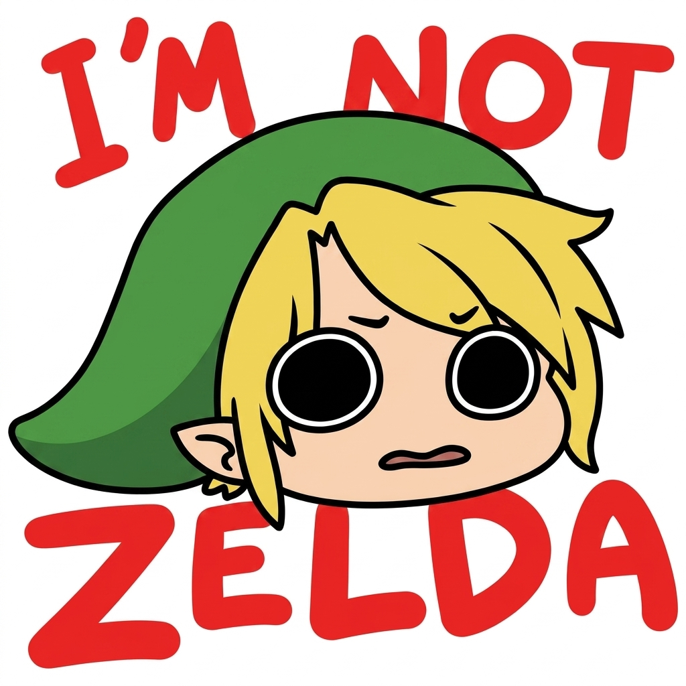

<p align="center">
  
</p>

<h1 align="center">HTTP Zelda</h1>

<p align="center">
  HTTP status codes
</p>

---


## Built with

- **Go**: the web server, using only the standard library (`net/http`, `html/template`)
- **PostgreSQL**: stores all the status codes
- **HTML & CSS**: server-rendered templates with a dark Zelda theme
- **Docker & Docker Compose**: runs the app, the database and the proxy together
- **Nginx**: reverse proxy in front of the app
- **golang-migrate**: database migrations
- **Air**: live reload while developing

## Run it

You'll need [Docker](https://docs.docker.com/get-docker/) installed.

1. Clone the repo:

   ```bash
   git clone https://github.com/selvingarcia/http-zelda.git
   cd http-zelda
   ```

2. Create a `.envrc` file with your settings and load it (`direnv allow` or `source .envrc`):

   ```bash
   export ADDR=:8080
   export DB_HOST=localhost
   export DOCKER_DB_HOST=postgres
   export DB_PORT=5432
   export DB_USER=zelda
   export DB_PASSWORD=change-me
   export DB_NAME=http_zelda
   export DB_SSLMODE=disable
   export DB_CONNECT_TIMEOUT=5
   ```

3. Start everything:

   ```bash
   docker compose up --build
   ```

4. Open [http://localhost:8080](http://localhost:8080) 

The database is created and filled with the status codes automatically the first time it starts.

## Project structure

```
cmd/web/        → the Go web server (handlers, routes, middleware)
cmd/migrate/    → SQL migrations
internal/       → database models and env helpers
ui/             → HTML templates, CSS and images
proxy/          → Nginx config
scripts/        → database seed script
codes.csv       → all the status codes and their descriptions
```

## Useful commands

```bash
make help          # list all commands
make migration_up  # run migrations
make seed          # load codes.csv into the database
```

## License

[Apache 2.0](LICENSE)
